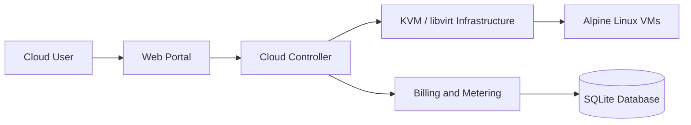
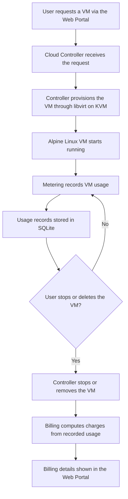

# KVM Private Cloud Portfolio

An academic private-cloud prototype that explores virtual machine provisioning, resource monitoring, lifecycle management, and usage-based billing on Linux virtualization.

## Introduction

KVM Private Cloud Portfolio demonstrates how core Infrastructure-as-a-Service concepts can be built on open-source tools. A web portal lets a cloud user request and manage virtual machines. A cloud controller translates those requests into libvirt operations on an Ubuntu Linux host running KVM/QEMU. A billing and metering component records VM usage in a SQLite database so that charges can be derived from usage.

The project was developed for academic purposes to study how the layers of a private cloud fit together.

## Project Objectives

- Provision virtual machines on a Linux host using KVM, QEMU, and libvirt.
- Manage the VM lifecycle (create, start, stop, and delete) through a web-based interface.
- Monitor VM resource usage.
- Meter VM usage and compute usage-based billing.
- Persist usage and billing records in a lightweight database (SQLite).
- Demonstrate a layered cloud architecture: portal, controller, hypervisor layer, and guest VMs.

## Architecture

The cloud user interacts with the web portal, which forwards requests to the cloud controller. The controller manages VMs through KVM/libvirt and passes usage information to the billing and metering component, which records it in the database.

## VM Provisioning and Billing Workflow

The diagram below shows the end-to-end flow from a VM request to a usage-based bill.

## Technology Stack

| Layer | Technology |
|---|---|
| Hypervisor | KVM and QEMU |
| Virtualization management | libvirt |
| Host operating system | Ubuntu Linux |
| Guest operating system | Alpine Linux virtual machines |
| Backend / controller logic | Python |
| Database | SQLite |
| Components | Web portal, cloud controller, billing and metering |

## Key Features

### Implemented

- VM provisioning on a KVM/QEMU host through libvirt
- VM lifecycle management
- VM resource monitoring
- Web portal for interacting with the cloud
- Cloud controller that coordinates portal requests and infrastructure operations
- Usage metering and usage-based billing
- Persistent usage records stored in SQLite

### Future Enhancements

The following are potential directions and are not part of the current implementation:

- User authentication and role-based access control
- Multi-host support and VM scheduling across hosts
- Live migration of virtual machines
- Network isolation and virtual network management
- Storage pools and volume management
- Automated tests and a CI pipeline
- Containerized deployment of the portal and controller

## Screenshots

## Limitations and Security Considerations

### Limitations

- This is an academic prototype and is not production-ready.
- It is designed for a single Ubuntu host and does not provide high availability or fault tolerance.
- Billing is a demonstration of usage-based charging and is not a payment or invoicing system.
- SQLite is suitable for a prototype but not for large-scale or highly concurrent workloads.
- The project has not been formally tested for scale or performance.

### Security Considerations

- The project has not undergone a security audit and makes no security certification claims.
- It should be deployed only in an isolated lab or test environment, not on public or production networks.
- Credentials, keys, tokens, and live database files should never be committed to the repository.
- Any real deployment would require, at minimum, authenticated access, encrypted transport (HTTPS), input validation, and least-privilege access to libvirt.
- Access to the libvirt interface and the host should be restricted to trusted users.

## Author

**Prashik**
GitHub: [prashik-vlsi](https://github.com/prashik-vlsi)