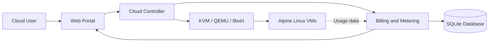
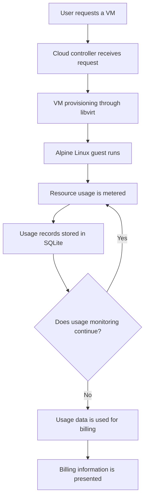

# KVM Private Cloud Portfolio

An academic private-cloud prototype demonstrating virtual machine provisioning, lifecycle management, resource monitoring, and usage-based billing using open-source Linux virtualization technologies.


---

## Overview

Commercial cloud platforms abstract away many of the layers that make Infrastructure-as-a-Service (IaaS) possible. This project explores those layers by building a small private-cloud prototype with open-source technologies.

The system brings together:

- A **web portal** for users to request and manage virtual machines.
- A **cloud controller** that coordinates portal requests with virtualization operations.
- A **KVM/QEMU virtualization layer**, managed through libvirt on an Ubuntu Linux host.
- **Alpine Linux guest virtual machines** for lightweight workloads.
- A **billing and metering component** that records VM usage in SQLite and supports usage-based charge calculations.

**Intended audience:** Students, technical reviewers, and engineering recruiters interested in Linux virtualization and private-cloud architecture.

**Scope:** This is a single-host academic prototype, not a production-ready cloud platform. See [Security and Limitations](#security-and-limitations).

## Key Features

| Capability | Status |
|---|---|
| VM provisioning through KVM/QEMU and libvirt | Implemented |
| VM lifecycle management: create, start, stop, and delete | Implemented |
| Alpine Linux guest instances | Implemented |
| VM resource monitoring | Implemented |
| Usage metering and usage-based billing | Implemented |
| Persistent usage records in SQLite | Implemented |
| Web portal and cloud controller | Implemented |
| Authentication and role-based access control | Planned |
| Multi-host support and VM scheduling | Planned |
| Live migration | Planned |
| Virtual network isolation | Planned |
| Storage pools and volume management | Planned |
| Automated tests and continuous integration | Planned |
| Containerized portal and controller | Planned |

*Feature statuses reflect the project's documented scope and have not been independently audited against the complete implementation.*

## Architecture

The intended workflow connects a user-facing portal to a cloud controller, which coordinates virtualization operations and usage metering.



| Layer | Responsibility |
|---|---|
| Web Portal | User-facing interface for VM management and billing information |
| Cloud Controller | Coordinates requests and virtualization operations |
| KVM / QEMU / libvirt | Provides virtualization and VM lifecycle management |
| Alpine Linux VMs | Runs lightweight guest workloads |
| Billing and Metering | Records usage and supports charge calculation |
| SQLite | Persists usage and billing-related records |

*The diagram represents the documented conceptual architecture; individual communication paths should be confirmed against the implementation.*

## How It Works



The documented workflow consists of the following stages:

1. A user submits a virtual-machine request through the portal.
2. The controller coordinates provisioning through libvirt on the KVM/QEMU host.
3. While workloads run, resource usage is monitored and recorded.
4. Usage records are persisted in SQLite.
5. The billing component uses recorded usage to derive charges, which can be presented through the portal.

The precise metering intervals, pricing rules, and lifecycle triggers depend on the implementation.

## Technology Stack

| Layer | Technology | Role |
|---|---|---|
| Hypervisor | KVM, QEMU | Hardware-assisted virtualization and VM execution |
| Virtualization management | libvirt | VM lifecycle and management interface |
| Host operating system | Ubuntu Linux | Host environment for virtualization |
| Guest operating system | Alpine Linux | Lightweight guest VM operating system |
| Backend | Python | Controller and billing application logic |
| Database | SQLite | Persistence for usage and billing records |

## Repository Contents

This repository is a **sanitized public presentation** of the project. Private keys, VM disk images, live databases, internal IP addresses, and credentials should remain outside the public repository.

```text
.
├── README.md
├── .gitignore
└── docs/
    └── portfolio-scope.md
```

The repository currently focuses on project documentation and publication scope. The implementation source code, setup scripts, and API definitions are not included in this public presentation.

### Screenshots

The following screenshots illustrate the project's terminal output and interface. Review each image for sensitive information before publishing.


## Security and Limitations

### Limitations

- This is an academic prototype and is not production-ready.
- The documented design targets a single host without high availability or fault tolerance.
- Usage-based billing demonstrates metering and charge calculation; it is not a payment-processing or invoicing platform.
- SQLite is suitable for lightweight prototype workloads but may not meet the requirements of highly concurrent, large-scale deployments.
- No performance, scalability, or independent security testing is claimed here.

### Security Considerations

- No security audit or security certification is claimed.
- Use the prototype in an isolated lab or test network rather than exposing it directly to the public internet.
- Authentication and role-based access control are listed as planned features and should not be assumed to be available.
- A real deployment would require authenticated access, HTTPS, input validation, secure secret management, restricted network exposure, and least-privilege access to libvirt.
- Never commit credentials, private keys, access tokens, live databases, or VM disk images.
- Review screenshots and logs for public IP addresses and other sensitive operational details before publishing them.

## Roadmap

The following items are planned improvements, not claims of completed functionality.

- [ ] Implement authentication and role-based access control.
- [ ] Add automated tests and a continuous-integration pipeline.
- [ ] Publish sanitized screenshots and selected implementation source.
- [ ] Document and verify installation instructions and API endpoints.
- [ ] Improve virtual-network isolation.
- [ ] Add storage-pool and volume-management support.
- [ ] Explore multi-host scheduling and live migration.
- [ ] Evaluate containerization for the portal and controller.

## Learning Outcomes

This project explores practical concepts in:

- Linux virtualization using KVM, QEMU, and libvirt.
- Provisioning and managing lightweight Alpine Linux guests.
- Integrating a portal, controller, and virtualization layer.
- Resource monitoring, usage metering, and usage-based charge calculation.
- Persisting operational data using SQLite.
- Evaluating the security, reliability, and operational gaps between an academic prototype and a production cloud.

## Author

**Prashik Wankhede**

- GitHub: [prashik-vlsi](https://github.com/prashik-vlsi)
- Project repository: [kvm-private-cloud-portfolio](https://github.com/prashik-vlsi/kvm-private-cloud-portfolio)

---

*Built as an academic cloud-computing project to explore private-cloud architecture and Linux virtualization.*
